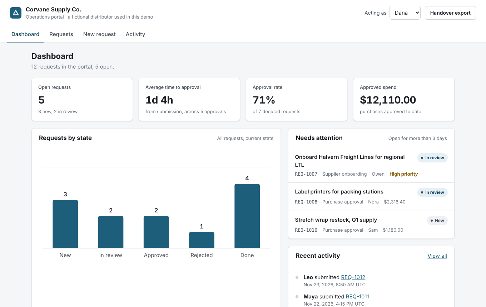
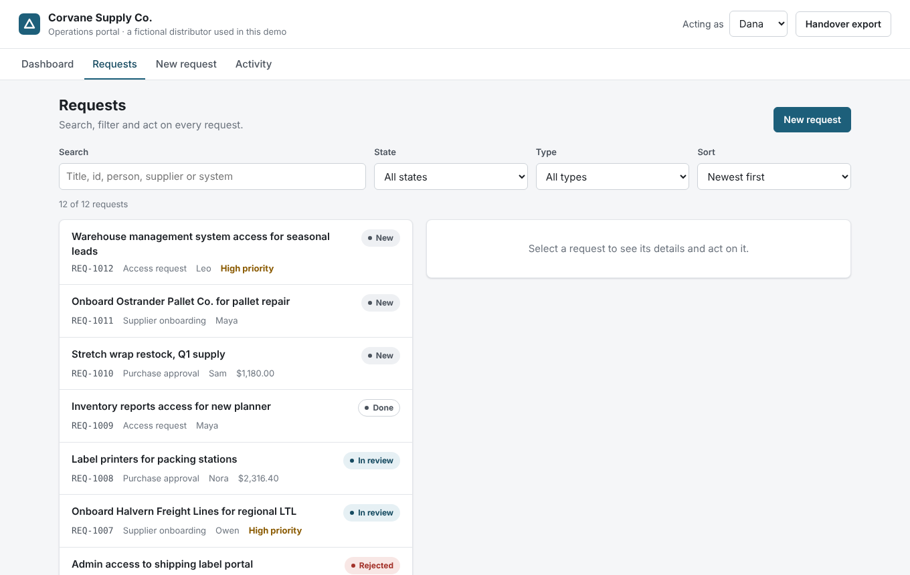

# ligatrix-demo-portal

A working operations portal for request intake, approvals and handover, built with plain HTML, CSS and JavaScript and a zero-dependency Node.js server.


The demo runs for **Corvane Supply Co., a fictional distributor used in this demo**. Every supplier, system and first name in it is invented.





## Why

Most companies run purchase approvals, supplier onboarding and access requests through email threads and a shared spreadsheet. Nobody can say what is waiting on whom, approvals happen in reply-all, and when someone asks "who signed this off, and when?" the answer is a search through inboxes.

This portal puts those requests in one place with a fixed workflow, a named approver on every decision, an activity log of who did what and when, and a dashboard that shows how long approvals actually take. When the work moves to another team or system, a single handover export carries the data and a description of its shape.

## Quick start

```sh
git clone https://github.com/Ligatrix/ligatrix-demo-portal.git
cd ligatrix-demo-portal
npm start
```

Then open <http://127.0.0.1:4173>. There is nothing to install: Node.js 20 or later is the only requirement. You can also open `index.html` straight from disk; the portal then runs in local demo mode, with the same rules, in memory.

## The main screen

```
┌──────────────────────────────────────────────────────────────────────────────┐
│ ▲ Corvane Supply Co.                              Acting as [Dana ▾]         │
│   Operations portal · a fictional distributor     [ Handover export ]        │
├──────────────────────────────────────────────────────────────────────────────┤
│  Dashboard   Requests   New request   Activity                               │
├──────────────────────────────────────────────────────────────────────────────┤
│  Requests                                                    [ New request ] │
│ [ Search title, id, person, supplier ] [All states ▾] [All types ▾] [Newest▾]│
│  12 of 12 requests                                                           │
│ ┌─────────────────────────────────┐ ┌──────────────────────────────────────┐ │
│ │ Warehouse system access…   New  │ │ REQ-1007  ● In review                │ │
│ │ REQ-1012 · Access · Leo         │ │ Onboard Halvern Freight Lines…       │ │
│ ├─────────────────────────────────┤ │ Type  Supplier onboarding            │ │
│ │ Label printers…       In review │ │ Requester Owen · Dept Operations     │ │
│ │ REQ-1008 · Purchase · $2,316.40 │ │                                      │ │
│ ├─────────────────────────────────┤ │ Next step                            │ │
│▌│ Onboard Halvern…      In review │ │ Comment [                         ]  │ │
│ │ REQ-1007 · Supplier · Owen      │ │ [ Approve ]  [ Reject ]              │ │
│ ├─────────────────────────────────┤ │                                      │ │
│ │ Admin access…          Rejected │ │ Activity                             │ │
│ │ …                               │ │ ● Dana started review · Nov 16       │ │
│ └─────────────────────────────────┘ │ ● Owen submitted · Nov 14            │ │
│                                     └──────────────────────────────────────┘ │
└──────────────────────────────────────────────────────────────────────────────┘
```

- **Dashboard**: open requests, average time to approval, approval rate, approved spend, a bar chart of requests by state (SVG drawn by code), requests open for more than three days, and recent activity.
- **Requests**: search across id, title, person, supplier and system; filter by state and type; sort by date, amount or priority; act on the selected request.
- **New request**: one form for purchase approvals, supplier onboarding and access requests. Fields appear by type and are validated by the same module the server uses.
- **Activity**: every change, newest first: when, who, which request, what changed and the comment.

"Acting as" switches between demo people, so you can watch the rules work: a requester cannot approve their own request, and a rejection needs a comment.

## The workflow

```
new ──start_review──▶ in_review ──approve──▶ approved ──complete──▶ done
                          │
                          └────reject───▶ rejected ──close──▶ done
```

Every change goes through one state machine (`src/domain/workflow.mjs`). It refuses moves from the wrong state, records the approver, comment and time on every decision, and writes an activity entry for each step.

## Usage

The server exposes a small JSON API next to the app. Real output from a fresh store:

```sh
$ curl -s "http://127.0.0.1:4173/api/requests?state=in_review&sort=oldest"   # trimmed
{ "count": 2, "requests": [ { "id": "REQ-1007", "title": "Onboard Halvern Freight Lines for regional LTL", ... }, ... ] }

$ curl -s -X POST http://127.0.0.1:4173/api/requests -H 'Content-Type: application/json' \
    -d '{"title":"Scanners","type":"purchase","department":"Warehouse","requester":"Nora"}'
{
  "error": {
    "code": "validation_failed",
    "message": "Some fields need attention.",
    "fields": {
      "amount": "Amount is required for a purchase.",
      "vendor": "Supplier is required."
    }
  }
}

$ curl -s -X POST http://127.0.0.1:4173/api/requests/REQ-1007/actions -H 'Content-Type: application/json' \
    -d '{"action":"approve","actor":"Owen"}'
{
  "error": {
    "code": "forbidden",
    "message": "The requester cannot decide on their own request.",
    "fields": {
      "actor": "Choose a different approver."
    }
  }
}

$ curl -s http://127.0.0.1:4173/api/summary
{
  "total": 12,
  "open": 5,
  "byState": { "new": 3, "in_review": 2, "approved": 2, "rejected": 1, "done": 4 },
  "averageTimeToApprovalMs": 103020000,
  "approvalRate": 0.7142857142857143,
  "approvedSpendCents": 1211000,
  "agingOpen": [ "REQ-1007", "REQ-1008", "REQ-1010" ]
}
```

| Method and path | What it does |
| --- | --- |
| `GET /api/health` | Liveness, schema version and request count |
| `GET /api/store` | All requests and the full activity log |
| `GET /api/requests?state=&type=&q=&sort=` | Filtered, sorted request list |
| `GET /api/requests/:id` | One request with its activity |
| `POST /api/requests` | Create a request (201, or 400 with field errors) |
| `POST /api/requests/:id/actions` | `{ "action", "actor", "comment" }`: 200, 403, 404 or 409 |
| `GET /api/summary` | Dashboard figures |
| `GET /api/export` | Handover bundle as a download |
| `POST /api/reset` | Reload the demo data (disable with `ALLOW_RESET=0`) |

The **handover export** (button in the header, or `GET /api/export`) is one JSON document: `format`, `schemaVersion`, `exportedAt`, a `schema` section describing every state, transition and field, the dashboard `summary`, every request and the full log. Check any store or bundle before you trust it:

```sh
$ npm run -s check-store -- data/store.json
data/store.json: OK (store, schema 1, 12 requests, 32 log entries)
```

Configuration (`PORT`, `HOST`, `DATA_FILE`, `ALLOW_RESET`), backups and restores are in [docs/runbook.md](docs/runbook.md). Modules, data flow and how to extend the portal are in [docs/architecture.md](docs/architecture.md).

## Design notes

- **No framework, no build step.** The app is plain ES modules served as files, so there is nothing to upgrade, no toolchain to keep alive, and a new engineer reads the code that runs. The cost is a little hand-written DOM code, kept small by a short helper (`src/ui/dom.mjs`) that never parses HTML.
- **One set of rules, two places.** The workflow, validation, metrics and export live in `src/domain/` as pure functions. The browser and the server import the same files, so the form and the API cannot disagree about what is valid.
- **The seed obeys the rules too.** Demo data is a timeline replayed through the same functions as real use, so seeded decisions and log entries can never contradict the workflow.
- **A JSON file as the store.** Atomic writes (temp file, then rename) and a write queue make it safe for a small team on one server, and a backup is a file copy. When volume or concurrency grows, the store sits behind four functions and can move to a database without touching the domain or the UI.
- **Money in integer cents, times in UTC ISO 8601.** No floating-point drift in totals, and every reader sees the same timestamp.
- **Works from disk.** Browsers refuse module imports over `file://`, so a checked-in classic bundle (`dist/portal.js`, written by `npm run bundle`) is loaded only in that case. A test fails if it falls out of date.

## Testing

```sh
npm test
```

88 tests with `node:test`: the state machine and its guards, intake validation edge cases, store operations, metrics, search and sorting, export and integrity checks, the HTTP API (status codes, body limits, static-file restrictions, persistence, concurrent writes) and the browser bundle. `npm run lint` checks for trailing whitespace, tabs and missing final newlines.

## Licence

[MIT](LICENSE)

---
Built and maintained by the [Ligatrix](https://ligatrix.com) team. We build systems like this for companies: [book a call](https://ligatrix.com/contact/sales).
